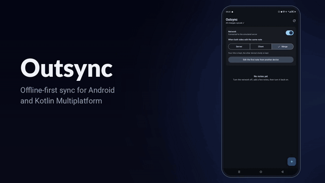

# Outsync

**Offline-first sync for Android and Kotlin Multiplatform.**
Your users keep working without a connection. Outsync saves every change locally, queues it, pushes it when the network is back, and resolves conflicts the way you choose.

[](https://github.com/imad213dev/outsync/actions/workflows/ci.yml)
[](https://jitpack.io/#imad213dev/outsync)
[](LICENSE)
[](https://kotlinlang.org)

<p align="center">
  
  <br>
  <sub>Recorded on a real phone. <a href="docs/outsync-demo.mp4">Watch with narration</a>.</sub>
</p>

## Why

Most apps show "No connection" and stop. The ones that don't (Notion, Todoist, Google Keep) built their own sync engines with dedicated teams.

Outsync gives you that engine as a library:

- **Local-first writes.** `save()` hits your database immediately. The UI never waits for the network.
- **Persistent outbox.** Pending changes live in SQLite and survive process death and reboots.
- **Smart queue.** Ten edits to the same item become one request. Create-then-delete offline sends nothing.
- **Ordered and safe.** Changes are pushed in order. A failure stops the queue instead of skipping ahead.
- **Conflict resolution.** Server-wins, client-wins, or your own field-level merge.
- **Automatic.** Syncs on app start, when changes are queued, and periodically, using WorkManager.
- **Bring your own stack.** Room, SQLDelight or anything else locally. REST, GraphQL or gRPC remotely. No vendor backend.

## Install

```kotlin
// settings.gradle.kts
dependencyResolutionManagement {
    repositories {
        maven("https://jitpack.io")
    }
}

// build.gradle.kts
dependencies {
    implementation("com.github.imad213dev.outsync:outsync-android:0.1.0")
}
```

Requires `minSdk 23`. Pure Kotlin projects can depend on `outsync-core` alone.

## Quick start

**1. Describe your model.** Outsync needs to know the id and the server version of an item. Your classes don't extend anything.

```kotlin
data class Note(val id: String, val title: String, val body: String, val version: Long? = null)

object NoteAdapter : EntityAdapter<Note> {
    override fun idOf(entity: Note) = entity.id
    override fun versionOf(entity: Note) = entity.version
    override fun withVersion(entity: Note, version: Long) = entity.copy(version = version)
}

object NoteCodec : PayloadCodec<Note> {
    override fun encode(value: Note) = Json.encodeToString(value)
    override fun decode(encoded: String) = Json.decodeFromString<Note>(encoded)
}
```

**2. Plug in your database.**

```kotlin
class NoteLocalStore(private val dao: NoteDao) : LocalStore<Note> {
    override suspend fun get(id: String) = dao.find(id)
    override suspend fun put(entity: Note) = dao.upsert(entity)
    override suspend fun delete(id: String) = dao.delete(id)
}
```

**3. Plug in your API** (see [Server contract](#server-contract)).

```kotlin
class NoteApi(private val api: NotesService) : RemoteSource<Note> {
    override suspend fun push(mutation: Mutation<Note>): PushResult<Note> {
        val response = when (mutation.kind) {
            Mutation.Kind.Upsert -> api.put(mutation.entityId, mutation.baseVersion, mutation.payload!!)
            Mutation.Kind.Delete -> api.delete(mutation.entityId, mutation.baseVersion)
        }
        return when (response.code()) {
            in 200..299 -> PushResult.Accepted(response.body())
            409 -> PushResult.Conflict(api.get(mutation.entityId).body())
            in 400..499 -> PushResult.Rejected(response.message())
            else -> PushResult.Retry()
        }
    }

    override suspend fun pull(cursor: String?): PullResult<Note> {
        val page = api.changes(since = cursor)
        return PullResult(
            changes = page.items.map { if (it.deleted) RemoteChange.Deleted(it.id) else RemoteChange.Upserted(it.note) },
            nextCursor = page.cursor,
            hasMore = page.hasMore,
        )
    }
}
```

Network exceptions thrown from `push` are treated as `Retry`, so you don't need to catch them.

**4. Create the engine once,** in `Application.onCreate()`:

```kotlin
class App : Application() {
    lateinit var notes: SyncEngine<Note>

    override fun onCreate() {
        super.onCreate()
        notes = outsyncEngine(
            context = this,
            name = "notes",
            adapter = NoteAdapter,
            local = NoteLocalStore(db.noteDao()),
            remote = NoteApi(retrofit.create()),
            codec = NoteCodec,
            resolver = ConflictResolvers.serverWins(),
        )
    }
}
```

**5. Use it.**

```kotlin
notes.save(note)
notes.delete(note.id)
```

That's it. Read from your own database as usual; Outsync keeps it in sync.

## Conflicts

A conflict happens when the server changed an item after the user started editing it offline.

```kotlin
ConflictResolvers.serverWins()
ConflictResolvers.clientWins()
ConflictResolvers.merge<Note> { local, remote -> local.copy(body = remote.body) }
```

Or write your own:

```kotlin
ConflictResolver<Note> { local, remote ->
    when {
        local == null || remote == null -> Resolution.TakeRemote
        local.body == remote.body -> Resolution.TakeLocal
        else -> Resolution.Merged(local.copy(body = remote.body + "\n\n" + local.body))
    }
}
```

If a conflict keeps coming back (`SyncConfig.maxConflictRetries`, default 3), Outsync keeps the server version and reports it, so the queue never gets stuck.

## Observing sync

```kotlin
val status by notes.status.collectAsStateWithLifecycle()

when {
    status.isSyncing -> Text("Syncing…")
    status.pendingCount > 0 -> Text("${status.pendingCount} changes waiting")
    else -> Text("All changes synced")
}
```

Rejected changes and abandoned conflicts arrive on `notes.events`. Events are buffered until collected, so none are lost if your UI isn't listening yet.

```kotlin
notes.events.collect { event ->
    when (event) {
        is SyncEvent.Rejected -> showError(event.reason)
        is SyncEvent.ConflictGaveUp -> showInfo("Your edit was replaced by a newer version")
    }
}
```

## Triggering sync manually

Outsync syncs on its own, but you can ask for it, for example when a push notification says data changed:

```kotlin
Outsync.requestSync(context, "notes")
```

Or call `notes.sync()` directly from a coroutine. Concurrent calls are safe.

## Server contract

Your backend needs two things. Most REST APIs are one small change away.

**Optimistic concurrency on writes.** Every item has a version that the server increments on each change. Writes carry the version the client last saw (`mutation.baseVersion`, `null` for new items). If it doesn't match the current version, reject the write (for example with HTTP 409) and return the current item.

**A changes feed.** An endpoint that returns everything changed since a cursor, including deletions, in order. The cursor is an opaque string to Outsync: a timestamp, a sequence number or a token all work.

```
GET /notes/changes?since=<cursor>
{ "items": [...], "cursor": "1842", "hasMore": false }
```

## Modules

| Module | Platform | Contents |
|---|---|---|
| `outsync-core` | Kotlin Multiplatform | `SyncEngine`, conflict resolvers, in-memory stores |
| `outsync-android` | Android | SQLite outbox, WorkManager auto-sync, `outsyncEngine()` |
| `sample` | Android | The demo app from the video, with a simulated server |

## Testing your integration

`outsync-core` ships `InMemoryOutbox` and `InMemoryCursorStore`, so you can test your `SyncEngine` setup on the JVM with a fake `RemoteSource`, without a device.

## Status

Outsync is **0.1.0** and still young. The API may change before 1.0. It has 24 tests covering offline writes, coalescing, ordering, conflicts, process death and races, and it has been exercised on real devices, but run it through your own scenarios before shipping it to production.

Planned:

- iOS targets for `outsync-core`
- Ready-made adapters for Room, SQLDelight and Ktor
- Batched pushes
- Maven Central publishing

Issues and pull requests are welcome.

## License

```
Copyright 2026 imad213dev

Licensed under the Apache License, Version 2.0
```

See [LICENSE](LICENSE).
